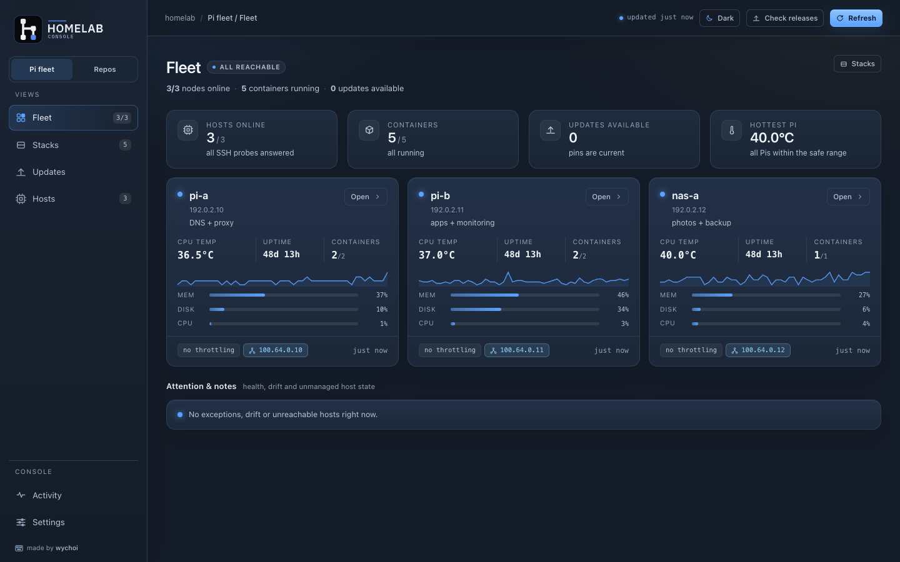

# Homelab-console

A local dashboard for a small Raspberry Pi homelab. Your Mac runs the console,
the Pis keep their containers running, and your fleet files stay in git.



## What it is

Homelab Console is a personal macOS app for management of Raspberry Pis. It shows
what is running, lets you review changes before they go to a Pi, and keeps the
stack files in git. There is no cloud account, no agent on the Pis, and no
telemetry.

This repository is the **app**. Your fleet lives in a **workspace**: the list of
Pis, the stack files you deploy, and your notes. The app can create one in an
empty folder; keep it in a private repo or back it up. The checkout includes
`examples/workspace/` for a safe first run.

It is deliberately **not** a hosted service, a Portainer clone, or a Kubernetes
manager. You own the files; the Pis are replaceable.

## What it does

- **Pi fleet** — uptime, temperature, throttling, containers, disks, RAID,
  Tailscale and failed services for every Pi.
- **Stacks** — review a diff, push a stack to a Pi, and check it stays healthy.
- **Updates** — check for new versions, apply them one at a time, snapshot
  first, and roll back if health checks fail.
- **Repo street** — find local git repos, commit selected files, push to
  GitHub, and mirror to Gitea as a backup.
- **Safety** — mark a stack critical, record what to back up, and review every
  change before it is applied.
- **Backup & restore** — one archive of hosts, stacks, repo folders and
  non-secret settings; restore writes a safety backup first.

## Quick start

1. **Run or build the console** (commands below), then open it.
2. **Choose a workspace.** An empty folder is fine: the app creates the host
   list and stack folder. Change it later from **Homelab Console → Choose
   Workspace…**.
3. **Add a Pi.** Open **Hosts → Add host**, enter its address and user, and
   follow the fingerprint and SSH-key prompts.
4. **Deploy a stack.** Open **Stacks → New stack**, pick a template, review the
   changes, and press **Push & up**.

Prerequisites, the support matrix and the full first-run walkthrough are in
[First-time setup](docs/getting-started.md).

### From a source checkout

macOS with Python 3.10+ is enough; the console uses only the standard library.

```sh
git clone https://github.com/awychoi/homelab-console.git
cd homelab-console
./hlc init --example ~/homelab/workspace   # sample host + whoami stack
./hlc --repo ~/homelab/workspace           # http://127.0.0.1:8765
./hlc doctor                               # tools, keys, hosts, reachability
```

Remove the example host before adding your own. `./hlc --help` lists
`serve`, `status`, `doctor`, `check-releases` and `init`.

### Build the macOS app

<details>
<summary>Build and sign <code>Homelab Console.app</code> yourself</summary>

There is no notarized download: build on the Mac that will run the app, then
sign it with an identity you control. A locally built app is not quarantined,
and a stable signature keeps Local Network and Keychain permissions across
rebuilds.

```sh
python3 -m venv .venv
./.venv/bin/python -m pip install "pyinstaller>=6.16"   # build-time only
desktop/build_app.sh                                    # ad-hoc
open "dist/Homelab Console.app"
```

A self-signed "Code Signing" certificate gives the bundle a stable identity:

```sh
HOMELAB_SIGN_IDENTITY="Homelab Console Dev" \
HLC_BUNDLE_ID=com.example.homelab-console \
desktop/build_app.sh
```

Building needs Xcode or the Command Line Tools. The script targets macOS 13 and
the current architecture, so build on Apple Silicon for arm64 and on Intel for
x86_64. The bundle ships `LICENSE`, `THIRD_PARTY_NOTICES.md`, `BUILD_INFO.txt`
and `licenses/`.

See [Build and sign it yourself](docs/building.md) for the full path, and the
[macOS app bundle](docs/macos-app.md) reference for signing internals,
workspace resolution and logs.

</details>

## Layout

| Folder | What it is |
|---|---|
| `app/` | The console: Python backend, web UI and tests. |
| `desktop/` | The macOS shell (Swift), PyInstaller spec and `build_app.sh`. |
| `docs/` | Setup, operations, troubleshooting and the reference pages. |
| `examples/workspace/` | A safe sample workspace. |

`./hlc` is the source launcher; `desktop/build_app.sh` builds the `.app`.

## Docs

| Start here | |
|---|---|
| [First-time setup](docs/getting-started.md) | Prerequisites, workspace, first host and first deploy. |
| [Using the console](docs/operations.md) | Settings, update sources, safety profiles, updates, Repo street and backups. |
| [Troubleshooting](docs/troubleshooting.md) | Common failures and current limits. |
| [Build and sign](docs/building.md) | Build the `.app` yourself, sign it, and share it. |

| Reference | |
|---|---|
| [Console reference](docs/console.md) | Architecture, behavior, API, safety model and limits. |
| [macOS app bundle](docs/macos-app.md) | Signing, workspace resolution and logs. |
| [Example workspace](docs/example-workspace.md) | The sample fleet layout. |
| [Security policy](SECURITY.md) | Threat model, secrets, reporting and scope. |
| [Third-party notices](THIRD_PARTY_NOTICES.md) | Bundled Python, OpenSSL and native-library licenses. |

## Status

Personal and experimental. Interfaces and storage formats can change; your
workspace files are the source of truth, and the Pis are disposable. There is
no notarized installer or auto-update; build and sign a copy you trust.

## License

MIT — see [LICENSE](LICENSE). Copyright (c) 2026 awychoi.

The macOS bundle embeds Python and native libraries; their notices and full
license texts are in [THIRD_PARTY_NOTICES.md](THIRD_PARTY_NOTICES.md) and
[`licenses/`](licenses/), and are copied into the app bundle by the build.

Provided as is, without warranty of any kind. Use at your own risk.
