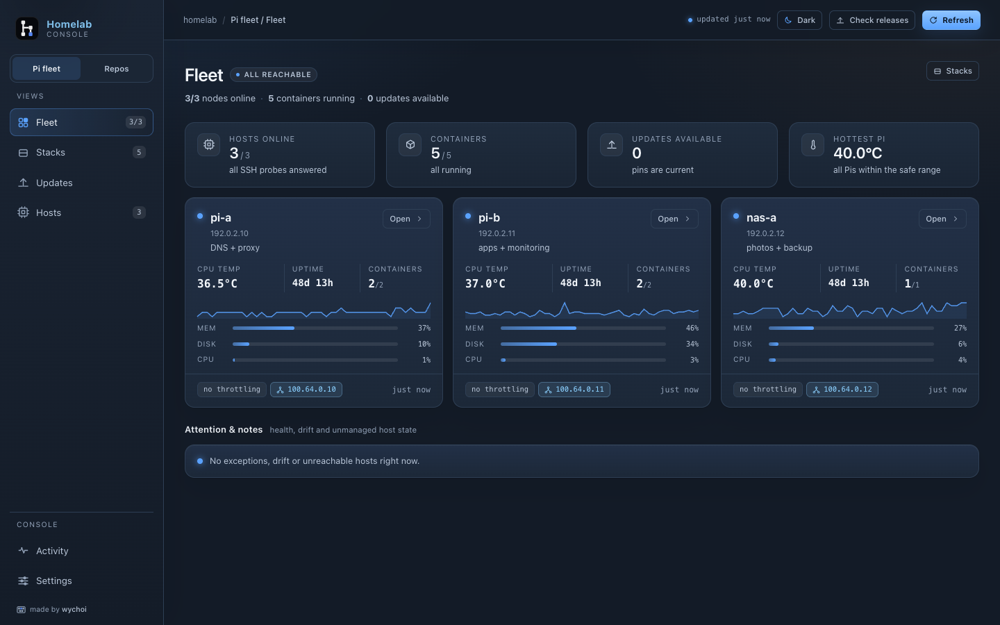
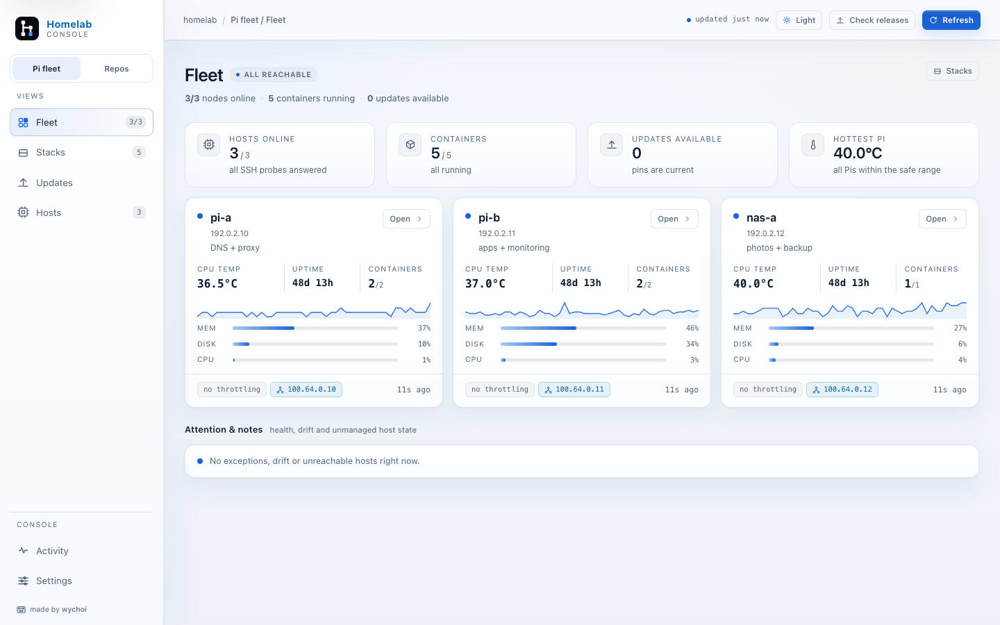
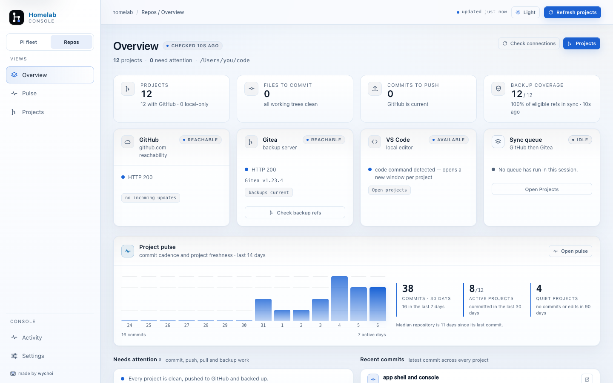
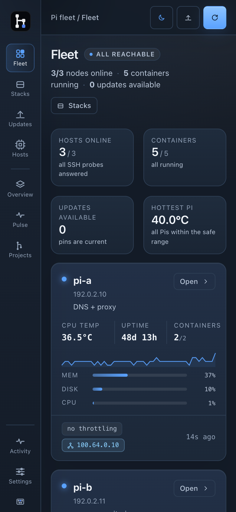
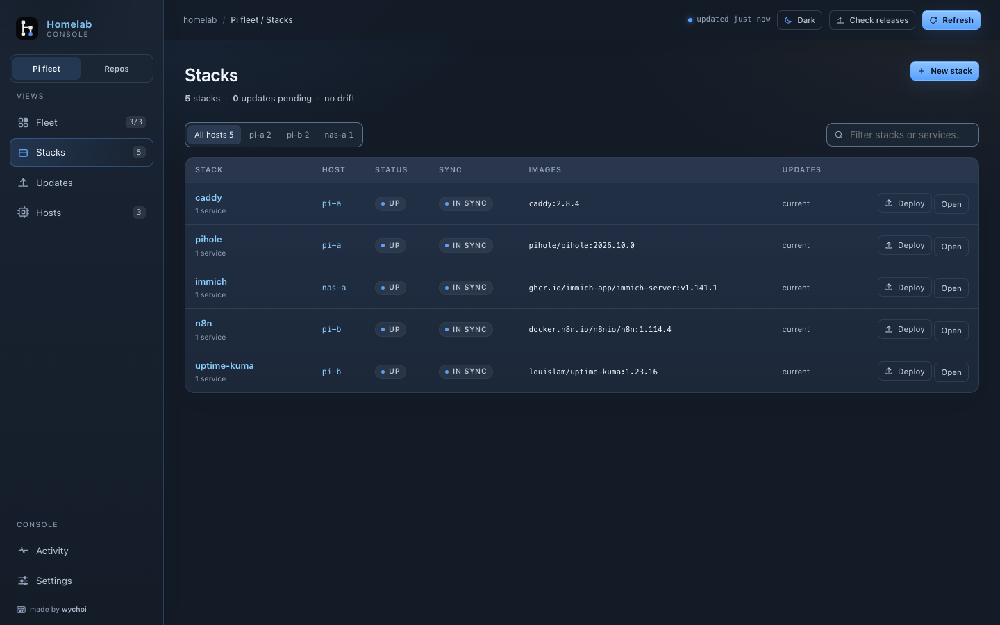
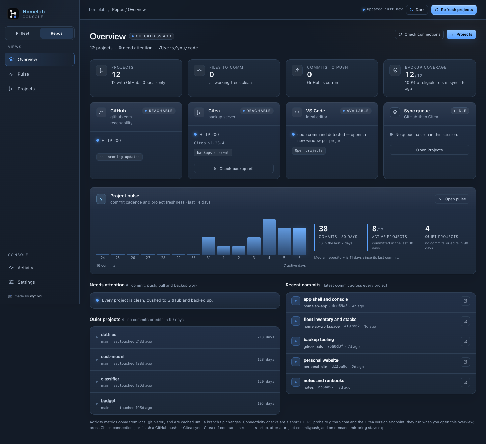
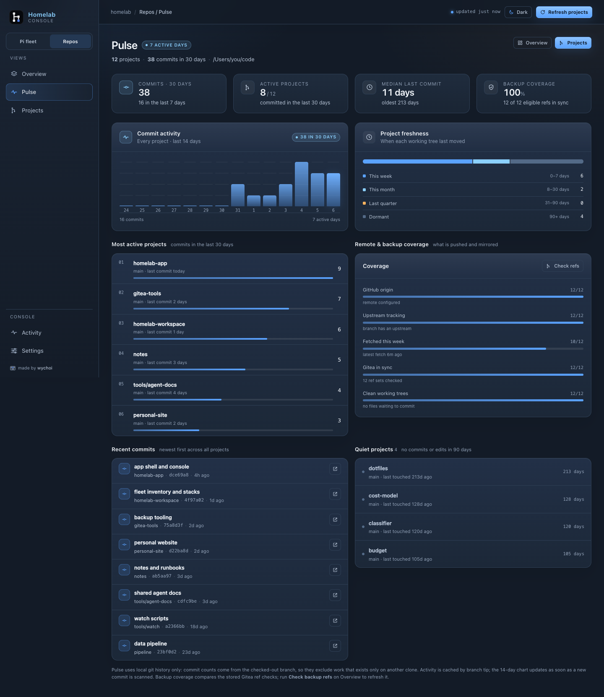
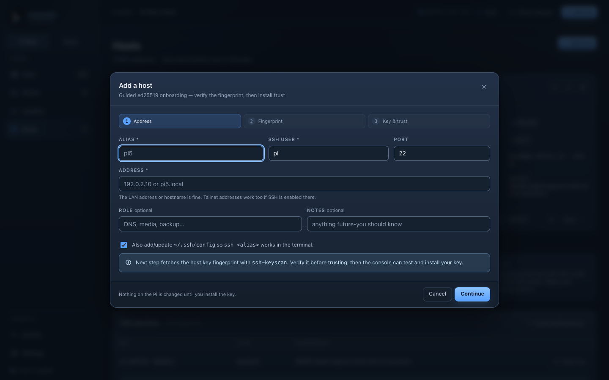

# Homelab Console


A local web app for the Mac with two workspaces: **Pi fleet** (status,
guided ed25519 onboarding, reviewable deploys, upstream release checks and
opt-in updates) and **Repos** (the local GitHub checkouts, their Gitea
backup and a project dashboard).



<sub>Screenshots are generated from the sanitized demo workspace in
`docs/assets/screenshots/demo/`; every address is documentation-only.</sub>

**New here?** Start with [First-time setup](getting-started.md), then
[Using the console](operations.md) and
[Troubleshooting](troubleshooting.md). This page is the implementation
reference: architecture, behavior, API, configuration and limits.

It is not a Portainer clone. The workspace under `stacks/` is still the
desired state, the Mac still pushes to the Pis, and nothing on a Pi is edited
by hand. The console wraps that contract in a visual control plane:

```text
   Mac                                                Pis
┌──────────────────────────────┐        ┌──────────────────────────────┐
│  stacks/<host>/<service>/     │  SSH   │  /opt/stacks/<service>/      │
│  docker-compose.yml + configs │ ─────► │  docker compose up -d        │
│  git                           │  tar   │  containers + host state     │
│  .hlc/ telemetry + snapshots  │ ◄───── │  uptime, temp, throttle, ... │
└──────────────────────────────┘  probe └──────────────────────────────┘
```

## Quick start

Requirements: macOS with `git`, `ssh`, `ssh-keygen`, `ssh-keyscan`, and
Python 3.10+; each Pi needs `ssh`, `python3` and Docker/Compose. The console
uses only the standard library, and the native app bundles Python.

```sh
./hlc                 # start on http://127.0.0.1:8765 and open a browser
./hlc status          # one-shot terminal fleet snapshot
./hlc doctor          # tools, keys, hosts.json and SSH reachability
./hlc check-releases  # refresh GitHub/Docker Hub and print update targets
./hlc serve --port 8766 --no-browser
```

The launcher prefers `.venv/bin/python`, then `python3`. The server binds
`127.0.0.1`; for remote use, tunnel it (`ssh -L 8765:127.0.0.1:8765 <mac>`).

The full fresh-install path — Pi prerequisites, **Choose Workspace…**, the
first host and first deploy — is in
[First-time setup](getting-started.md).

<details>
<summary>Startup and warm-up behavior</summary>

The console is a long-lived server, so "startup" means process start. On
launch it runs the expensive checks once, in parallel: the SSH fleet probe, the
local project scan, and one Gitea ref comparison queued behind the first scan.
The browser shows a progress screen listing those three tasks instead of empty
tiles filling in one at a time; `/api/state.warmup` drives it.

The gate is deliberately soft. It releases when every task is terminal **or
after 12 seconds**, so an unreachable Pi cannot hold the UI hostage, and each
check is independently time-boxed. Failures are terminal too: a Gitea outage
shows an amber row and then the dashboard's attention list, not a stuck splash.
If the startup Gitea check reports errors it retries once after 30 seconds, so
a cold-launch network blip does not leave a stale "unreachable" until you
click. Unreachable details include the address the app resolved, which is the
fastest way to spot a terminal-vs-app DNS disagreement.
The Gitea task appears only when a project folder is configured, the Gitea URL and
owner are set, and `gitea_check_on_start` is on; a missing token is fine because
the credential helper is a supported auth path. The per-project ref probes run
four at a time, which puts a ten-project check under three seconds on a modern Mac.

After startup the cheap local project scan keeps polling and the fleet keeps its
telemetry heartbeat; the network Gitea check is startup, post-action, or manual.

</details>

### Run as a macOS app

`desktop/build_app.sh` produces `Homelab Console.app`: a **Swift** shell
(AppKit + WKWebView) that owns a native window, the menus and the backend's
lifecycle. The Python console runs as a child process built by PyInstaller, so
PyInstaller is a build-time dependency only and the console stays stdlib-only.

The shell picks a free loopback port, starts `serve --no-browser`, waits for
`/api/health`, then loads the page in the webview. Closing the console window
quits the app and terminates the child; there is no login item or background
mode. A crash or Force Quit is covered by a parent watchdog in the backend, so
no server is left holding a port. Logs: `~/Library/Logs/Homelab Console/sidecar.log`
and `<workspace>/.hlc/logs/console.log`.

Signing defaults to ad-hoc; see
[Build and sign it yourself](building.md). The Gitea token moves to the
macOS Keychain in app mode (the shell passes `HLC_GITEA_TOKEN` with `HLC_APP=1`),
so Settings hides the token field.

<details>
<summary>Workspace fallback and bundle contents</summary>

A Finder-launched app has no checkout next to it, so `_find_repo()` falls back
to a workspace under `~/Library/Application Support/Homelab Console/workspace`
and creates `stacks/`, `scripts/hosts.json`, `.gitignore` and `.hlc/` there.
Use **Homelab Console → Choose Workspace…** to pick an existing workspace; the
shell writes the pointer and restarts the backend. `HLC_WORKSPACE` and
`HLC_REPO` do the same from a terminal.

The bundle carries its own [third-party notices](../THIRD_PARTY_NOTICES.md) and
full license texts under `Contents/Resources/licenses/`, plus `BUILD_INFO.txt`
with the build's Python/OpenSSL/SQLite/PyInstaller versions.

</details>

Signing internals, workspace precedence and the shell's limits are in
[macOS app bundle](macos-app.md).

### Appearance

The console ships with three appearance modes, chosen from the top-bar control
or **Settings → Appearance**:

| Mode | Look |
|---|---|
| **System** (default) | Follows the macOS appearance and switches live when the OS does |
| **Dark** | Deep slate surfaces, soft white text, blue primary actions, amber for updates and warnings |
| **Light** | White/cool-white surfaces, blue primary actions, amber accents, dark text |

A fresh install follows macOS. The choice is stored server-side in
`.hlc/config.json`, so a reload or another tab picks it up; `localStorage`
mirrors it for a flash-free first paint. The top-bar button cycles
System → Dark → Light.





### Layout, mobile and accessibility

<details>
<summary>Rail behavior, responsive breakpoints, keyboard and screen-reader support</summary>

The shell has three parts: a persistent left rail, a slim top bar for context
and fleet-wide actions, and one content column capped at 1500px. The rail is
split into two workspaces at the top — **Pi fleet** and **Repos** — with
the active workspace's views below and universal **Activity** / **Settings**
pinned at the bottom. The workspace switch preserves the last workspace while
you are in the universal pages. The **Pi fleet** workspace badge counts
available updates; the **Fleet** view below it keeps the online/total host
count, and **Repos** counts projects needing attention. The top bar
is context-aware: releases are a Pi action and are hidden in Repos, where
the refresh button becomes **Refresh projects**; host and stack pages put the
actual host/stack name in the crumb and in the window title.

Settings is long by design, so its sticky **Jump to** bar exposes Appearance,
Collection, Sources, Console, Repos, Backup, Safety and Maintenance without
a detour through the page. The active chip follows scrolling; clicking a chip
pins it so the last sections at the bottom of the page cannot leave an earlier
chip highlighted.

 The top bar reads like
`homelab / Repos / Projects`, so the workspace and view are always
explicit.

Narrow screens adapt rather than hiding controls:

- At 900px the two-workspace rail is replaced by one compact rail: every Pi and
  Repos view is one click away, with a short visible label under each icon
  (`Overview` / `Pulse` / `Projects` for the three Repos views) plus the full
  accessible name and native tooltip. Short windows reduce item padding so the rail still fits.
- At 700px the top-bar actions (theme, check releases, refresh) become larger
  icon buttons with the same accessible names and native tooltips.
- At 600px stat tiles pack two-up, key/value rows stack, and the attention list
  becomes stacked rows with their own Open buttons.
- The Stacks table becomes stacked stack cards at 900px so status, sync, images,
  updates and actions stay reachable without sideways scrolling. Between 901
  and 1280px the Images column is folded under the stack name, and the
  Projects table becomes stacked project cards at 700px so dirty/Gitea chips and
  actions stay reachable.
- The Repos dashboard health cards stack to one column at 700px.

Keyboard and assistive-tech support is part of the shell:

- A skip link jumps straight to the content, and every interactive control has
  a visible `:focus-visible` ring.
- Dialogs are labelled, trap focus, make the background inert, close on Escape
  and return focus to the control that opened them.
- Tabs expose `aria-selected` and respond to arrow keys; host filters and
  theme choices expose `aria-pressed`. The settings jump bar exposes
  `aria-current="location"`. Icon-only controls carry both `aria-label` and
  `title`.
- Toasts announce through `role="status"` / `role="alert"`, carry a dismiss
  button, and pause their timer while hovered or focused. Charts and uptime
  strips have descriptive labels, and `prefers-reduced-motion` disables
  transitions.
- Muted and semantic text is tuned per theme for AA contrast instead of being
  derived from opacity; the dim tokens are deliberately different in dark and
  light, and primary-button labels switch ink/white with the accent surface.

</details>

### Local state

On first launch the console creates a gitignored `.hlc/` state directory:

| Path | Contents |
|---|---|
| `.hlc/console.db` | SQLite telemetry samples, events, runs, policies |
| `.hlc/config.json` | local settings (mode 600; may contain GitHub/Gitea tokens) |
| `.hlc/cache/releases.json` | upstream release cache |
| `.hlc/runs/*.log` | full logs for every deploy/update/rollback |
| `.hlc/snapshots/` | pre-update copies of stack files (mode 600) |

### Backup and restore

**Settings → Backup & restore** writes one zip of `hosts.json`, every stack
file (including `.env`-family secrets) and all non-secret settings; tokens and
`.hlc/` state are excluded. Restore validates the archive, writes a
`pre-restore-*.zip` into `.hlc/backups/`, then replaces hosts, stacks and
settings. The archive is mode 600. Full behavior:
[Using the console → Backup and restore](operations.md#backup-and-restore).

## The mental model, kept intact

- **The repo is desired state.** The console writes compose files in
  `stacks/<host>/<service>/` first, shows a diff, then streams a tar to
  `/opt/stacks/<service>/` on the host.
- **Every write is gated.** Overwriting a host file requires reviewing the
  plan; the API rejects a missing or stale plan hash, and update actions carry a
  review hash bound to the target/value. Destructive changes need approval.
- **Host-only files are not destroyed by a push.** Extra files on a Pi
  (runtime state, old configs) are listed as *extra* and left untouched. This
  is deliberately more forgiving than the CLI's remote-only gate; they are
  still surfaced in Files, where you can remove them deliberately.
- **No hand edits on the Pi.** If drift is detected, the host file's hash no
  longer matches the repo and the stack is marked *drift*. The fix is a repo
  edit plus deploy — not an SSH edit.
- **Secrets stay gitignored.** `.env`, `.env.*` and `*.env` files are pushed
  to the Pi but never committed. `.hlc/` only ever contains secret material in
  mode-600 files inside a gitignored directory.

## What it does

### Fleet and service monitoring

- Live SSH probe per host with cached snapshots (default every 30s).
- Uptime, CPU temperature, throttling flags decoded from `vcgencmd
  get_throttled`, load, memory, disk, Docker/Compose versions, Tailscale
  identity, NTP, failed units, RAID state and listener ports.
- Container state, Docker health, restart counts, OOM kills, image tags and
  digests, and the compose project they belong to.
- Per-stack status: `up`, `degraded`, `down`, `not deployed`, plus repo sync
  state: `synced`, `drift`, `extra`, `unknown`.
- Host-only directories under `/opt/stacks` are surfaced as unmanaged.
- 24h samples power availability strips and temperature sparklines.



### Stack files and folders

Deploy uploads **every file in the stack's repo folder** — the compose file,
`.env`, and any configs next to it. The **Files** tab creates files at any
relative path (parent folders are automatic, `.env`-family files are mode 600);
the **Folders** tab lists host paths and bind mounts with a **Terminal** action.
Stack discovery is exactly `stacks/<host>/<stack>/<compose-file>`; a compose
file one directory deeper is reported, not adopted.

<details>
<summary>Files, host-only paths and the Folders tab</summary>

The **Files** tab can create a new text file at any relative path; parent
folders are created automatically, and `.env`, `.env.*` and `*.env` files are
written mode 600. This is how service configs (`prometheus.yml`,
`mosquitto.conf`, a `Caddyfile`, and so on) get into the repo without leaving
the app.

The tab also lists *host-only paths*: files that exist only on the Pi (old
configs, runtime state). They are never uploaded and never deleted by a deploy.
Each one can be removed deliberately (with a confirmation), or all at once,
which is how stale runtime directories get cleaned up. The fleet's “extra files”
attention now opens this tab directly instead of the stack overview.

The **Folders** tab lists the host stack directory and every bind mount exposed
by the running containers, with a **Terminal** button that opens an SSH session
at that path. Empty `/opt/stacks` directories in Attention & notes get the same
Terminal action, so an empty `vaultwarden/` can be inspected and removed without
a separate SSH login. The native shell writes a temporary `.command` file and
opens it with Terminal — no Automation permission. In the browser UI there is
no native bridge, so the SSH command is copied to the clipboard instead.

Nested directories below the stack are ordinary files and are pushed with it,
but a compose file one directory deeper is not adopted as a second stack.
**Stacks** shows an “Ignored nested stack layout” warning for compose files
outside the contract, and `./hlc doctor` reports the same paths.

</details>

### Repos



The **Repos** workspace has three views: **Overview** answers "what needs me now?",
**Pulse** answers "what is changing over time?", and **Projects** is where you
commit, push and mirror. The UI calls each managed checkout a **project**; the
HTTP API and git commands still use repository terminology.

- **Overview** keeps the fleet totals, GitHub/Gitea/VS Code/queue health, a
  14-day commit pulse, the action queue and the latest commit in each repo.
  Backup coverage shows *synced / eligible* rather than a bare "0", so an
  unconfigured or ineligible Gitea is not mistaken for a failing backup.
  Connectivity is probed when the page opens, on demand and after a push/sync;
  the Gitea ref comparison runs at startup, after a local commit/push, and on
  demand — never on a timer.
- **Pulse** adds commit cadence, freshness, remote/backup coverage and quiet
  projects: commits in the last 7 and 30 days, active projects,
  median/oldest last commit, a 14-day bar chart, the most active projects,
  a GitHub/upstream/fetch/Gitea/clean-tree coverage breakdown, recent commits
  and projects with no commit or working-tree edit for 90 days.
  **Check refs** on the coverage card runs the same read-only Gitea comparison
  as Overview.
- **Projects** lists branch/upstream, dirty files, conflicts, ahead/behind,
  Gitea state and last commit. **Commit** stages only the checked paths
  (`.env`-family files and ignored paths are refused); **Push** sends the
  current branch with your credential helper; **Check Gitea** previews and then
  mirrors heads/tags; **Queue both** runs GitHub → Gitea serially.
  **Open in VS Code** launches `code -n`.



Activity numbers come from local git history. The backend caches each repo's
commit counts by branch tip for five minutes, so the 10-second status scan does
not re-walk history on every tick. "Last touched" is the newer of the last
commit and the mtime of dirty paths (at most 50 stats, no git process); that is
why an actively edited but rarely committed repo is not called dormant. A
"behind origin" count is only as fresh as the last fetch, and the coverage card
shows the age of the newest `FETCH_HEAD` so the number can be trusted. No fetch,
pull, network call or destructive git action is performed by Pulse.

<details>
<summary>Project discovery, Gitea auth and sync details</summary>

- Scans every configured project folder **recursively** for git checkouts,
  including the configured folder itself, so a folder of projects and a single
  project folder both work. Hidden folders, dependency/build folders
  (`node_modules`, `.venv`, `build`, `dist`, `target`, …) and nested checkouts
  inside an already-found project are skipped. Use **Manage projects…** to deselect
  individual checkouts; they stay on disk but disappear from Repos.
  Folders are empty until chosen in Settings or the Projects setup card;
  add as many as needed, with **Choose folders…** for a native multi-select or
  by typing a path.
- The **Projects** view lists every project: branch/upstream, dirty files,
  commits ahead/behind origin, Gitea backup state, last commit and direct
  GitHub link. The GitHub column is the accurate state (`7 ahead`, `up to
  date`, `2 behind`, `local only`); **Push** is the action that sends the
  current branch. A repo with no upstream still reports ahead/behind against
  `origin/<branch>` when that ref exists.
- The dashboard highlights up to nine tasks that need action and offers
  **Review** shortcuts into the filtered Projects table. Conflicts, local
  changes, push work and backup gaps are called out; dirty items include staged,
  unstaged, new and ignored counts plus the last touched age. A repo with
  commits behind origin shows a download icon and an **Updates** filter, based
  on the last fetch, and the fetch age is shown in Pulse coverage.
- **Open in VS Code** launches `code -n` with the repo path; the app falls
  back to the macOS application path if the `code` shell command is missing.
- **Commit** opens a checklist of changed and untracked files with an editable
  message. Paths matching `.gitignore` are hidden from selection, including
  tracked files that later became ignored; the API rejects them too. Build
  noise (`__pycache__`, `.pyc`, `.DS_Store`, `node_modules`, `.venv`) starts
  unchecked. Nothing is committed until you click; no auto-commit and no bulk
  commit.
- **Push** sends only the current branch to GitHub, setting upstream on the
  first push and never forcing. Authentication is the operator's existing git
  credential helper; the console never stores or uses a GitHub token for
  pushes. Private repos open normally through the browser session. Pushing the
  branch behind an open pull request updates that PR normally; the console does
  not create or manage PRs, and for a fork `origin` must point at the fork you
  can write to.
- **Gitea** is a backup mirror: `Check Gitea` compares local heads/tags with
  the remote on demand, and a sync previews the ref changes before applying
  the same all-heads/all-tags `prune` + `force` push as `gitea-tools`. Missing
  Gitea projects rely on push-to-create. LFS, shallow and unrelated-history
  projects are skipped with a reason; the duplicate-history check runs before
  any write.
- **Queue both** is a serial queue: GitHub push (when the current branch is
  ahead), then Gitea mirror, per project. If GitHub fails, Gitea is still backed
  up and the queue continues. The full run is streamed in the usual run log
  and the queue card retains per-project GitHub/Gitea results.
- Automatic Gitea ref checks (`gitea_check_on_start`) run **once at startup**,
  queued behind the first local scan, and recheck the **affected project after a
  commit or GitHub push**; **Check Gitea** always works on demand. There is no
  timer and no background Gitea network loop. Local dirty/ahead status refreshes
  every 10 seconds (configurable). A startup check does not need a stored token:
  the credential helper is used when the token setting is empty.
  Gitea auth precedence is `HLC_GITEA_TOKEN`, `GITEA_TOKEN`, the token in
  `.hlc/config.json` (mode 600, never returned by the API), then the git
  credential helper. In the native app the token lives in the macOS Keychain;
  the shell passes it as `HLC_GITEA_TOKEN`.

</details>

### Guided ed25519 onboarding



Alias → fingerprint verification → key install (one-time password, or the
manual command when password auth is off) → side-effect-free SSH probe.
`~/.ssh/config` is updated by default, with a backup. The walkthrough is in
[First-time setup](getting-started.md).

The host entry is written to `scripts/hosts.json` — the same file the retired
`deploy.py`, `fleet_run.py` and `update_run.py` runners read — with only additive
fields (`port`, `key`, `role`, `tags`, `added`). Unknown metadata and the
`location_` marker are preserved.

### Deploy with a real gate

- Diff view per file with added/changed/extra classification.
- The deploy button sends the plan hash; if anything changed, the server
  returns 409 and the UI re-reviews instead of deploying blind. A request without
  a plan hash is rejected.
- Destructive changes require an explicit checkbox; add-only files flow.
- Compose is validated with `docker compose config --quiet` in a **temp
  staging directory** on the host *before* `/opt/stacks` is touched.
- Push is a tar stream, then `docker compose up -d --remove-orphans`.
- The tar is unpacked into a staging directory and every destination is
  probed for replaceability before the live stack is touched, so a refused
  write cannot leave a half-pushed stack. If a container has chowned its
  bind mount (SearXNG's entrypoint does this by default when it runs as
  root), the console repairs ownership with passwordless `sudo chown` and
  says so in the run log; without sudo it stops with the offending paths and
  the exact repair command. A failed push therefore reports whether anything was
  written, and the update rollback re-pushes only when it was.
- "Pull & recreate" refreshes images; "Restart" and "Down" never push files.

### Updates that verify themselves

The update flow is:

```text
snapshot repo files
  -> rewrite the pin (compose image line or .env variable)
  -> validate compose in a staging dir on the host
  -> push
  -> pull only the affected services
  -> docker compose up -d
  -> wait for Docker health + loopback TCP checks
  -> on failure: restore snapshot, push, up again
```

- **Green means containers and their published ports.** Every expected
  container must be `running` (and `healthy` where a healthcheck exists), then
  the gate opens one loopback TCP connection to each published port. The probe
  connects and closes immediately (`exec 3<>/dev/tcp/...`), so a container
  that is "healthy" while its port is closed fails verification — and the run
  log names the exact `service:port` under `ports failing:`.
- Critical stacks require an explicit backup acknowledgement. The stack's
  **Safety & backup** profile supplies the data paths, the pre-update note,
  and an optional PostgreSQL dump plan. The update dialog shows the latest
  scheduled backup (name, size, age and exact time) alongside any
  console-created copy; **Dump fresh copy on Pi** streams `pg_dumpall` into the
  configured console folder, validates it, and keeps it on the Pi for a local
  restore.
- **Update all…** queues available updates for one Pi or the whole fleet. The
  queue is serial: the next update starts only after the previous run has
  passed its health checks. Critical stacks are excluded and must be applied
  individually; the queue stops at the first failure and skips the rest.
- **Data volumes are never backed up automatically.** The UI states what to
  snapshot; compose files are what roll back automatically.

<details>
<summary>Pins, compatibility-managed images and release age</summary>

- A shared env pin is updated once and covers every service that references
  it (for example Immich's `IMMICH_VERSION` server + machine-learning pair).
- Compatibility-managed images are reported, never proposed as updates.
  Immich's Postgres and Redis are managed only inside an Immich stack; a
  Redis image used by any other stack is checked normally.
- The Latest column shows when the candidate release was published, using the
  Docker Hub tag timestamp or the GitHub release date, so a release can be
  judged by age as well as version.
- The built-in Immich profile remains the default for a stack named `immich`.
  Any other stack can be marked critical and given its own PostgreSQL plan
  without editing Python.

</details>

### Auto-update policies

- Per-stack policy: `off`, `notify` or `auto`.
- `auto` is inert until **Enable automatic updates** is on in Settings.
- The sweeper runs at most one update at a time, only for stacks that are
  healthy and in sync, skips critical stacks, and applies a six-hour cooldown
  after a failed attempt.
- Every attempt is recorded in Activity and in the policy row
  (`last_applied_version`, `last_error`).

### Release intelligence

<details>
<summary>Docker Hub tags, CPU filtering, GHCR sources and the release cache</summary>

- Docker Hub images are compared against the **actual tag list**, not GitHub
  release names. Variant awareness means an `-alpine` pin is compared against
  `-alpine` tags; arch/builder/nightly/rc tags are filtered out.
- **Candidates are filtered by the target host's CPU.** Docker Hub's tag
  metadata lists the platforms in each image, and the console indexes them per
  architecture (from the host's `uname -m`). A tag that exists for amd64 but
  not arm64 is shown with a “has no arm64 build” note and is never offered as
  an update on that host. If a newer compatible tag exists, it is proposed
  instead. This prevents a push that can only fail at
  `docker compose pull` with `no matching manifest`.
- GHCR products with a known source (Immich) use GitHub releases, preserving
  the tag's `v` convention. An `org.opencontainers.image.source` label is used
  when the running container exposes one.
- `lscr.io/linuxserver/*` images resolve to their Docker Hub
  `linuxserver/*` mirror. Other registries (`quay.io`, private registries) are
  marked unmanaged rather than guessed as Docker Hub.
- Official per-architecture Docker Hub images (`arm64v8/caddy`,
  `amd64/nginx`, …) stay Docker Hub sources even though their OCI label points
  at the upstream GitHub project. That keeps release checks on the tag list
  that actually has the image.
- **Settings → Update sources** adds or overrides a source per image
  (`dockerhub`, `github`, `managed`, or `unknown`). Custom sources win over the
  catalog and auto-detection. The Settings page lists detected images with a
  source dialog for each, including a likely GitHub repository suggestion for
  GHCR images.
- SearXNG calendar tags and n8n's hash-suffixed tags are handled explicitly.
- Images with no update source are marked unmanaged rather than guessed.
- `:latest`/unpinned images are flagged separately with two safe actions:
  pin to latest stable, or pin to the digest of the image that is currently
  running.
- Latest release age comes from the Docker Hub tag `last_updated` timestamp,
  or GitHub's `published_at`; cached entries are refreshed once if they lack
  age metadata.
- Cache TTL is six hours by default; the global **Check releases** action
  forces a refresh. A GitHub token is optional but raises the anonymous API
  limit. Page-specific release-check buttons were removed so there is exactly
  one release-check control.

</details>

### Activity and git hygiene

- Health transitions, release detections, deploys, updates, rollback and
  commits are recorded. Every run has a full log.
- The workspace repository panel shows branch, last commit and dirty files under
  `stacks/` + `scripts/hosts.json`.
- **Commit changes** writes a local git commit of exactly those paths. It never
  commits `.env`-family files, never pushes, and never runs without your click.

## Safety & security

- Server binds loopback only and rejects a foreign `Host` header, so a
  DNS-rebinding page cannot read the SPA token. Every API call needs the
  per-process `X-HLC-Token`; mutating requests also reject cross-origin browser
  requests. SSE uses a short-lived, run-scoped `stream_token`, not the session
  token in a URL.
- HTML is served with a strict CSP (`script-src 'self'`, `base-uri 'none'`,
  `form-action 'none'`, `object-src 'none'`), no external assets, no CDN, no
  analytics. Host-derived fields are escaped.
- SSH arguments are built as argument vectors with `shlex.quote`; host aliases,
  users, ports and stack names are validated before use. Onboarding requires
  explicit fingerprint verification and pins the key in `known_hosts`.
- File reads and writes are confined to the stack directory; symlinks, path
  traversal and unsafe compose `env_file` paths are rejected. Compose files are
  parse-validated before save.
- Deploys require a reviewed plan hash. Update actions require a review hash
  bound to the target/value; Gitea force/prune syncs require the dry-run hash.
- Passwords are used once for `authorized_keys` installation and never stored
  or logged. Manual key installation is always offered as a fallback.
- The API has no arbitrary command runner. The native Terminal bridge accepts
  only a main-frame message from the console origin, and external URLs open in
  the default browser rather than the privileged webview.
- Repos rejects dangerous project-local Git configuration, disables
  `core.fsmonitor` and hooks for its Git calls, and scopes the Gitea
  Authorization header to the configured Gitea base. Redirects never carry
  credentials. Gitea must use HTTPS off loopback (or set
  `HLC_GITEA_ALLOW_HTTP=1` for a trusted network).
- `.env` contents are visible in the local file editor (that is the point);
  the token gate and loopback bind are the boundary. The workspace and Repo
  street commit actions filter `.env`-family files server-side.

## Deliberate limits

- **No automatic data backups.** The console snapshots repo files before an
  update; it never copies data volumes. A stack profile can enable a Pi-local
  PostgreSQL `pg_dumpall` from the update dialog (Immich is the built-in
  default; other stacks can add their own plan). Non-Postgres state still
  needs your own routine.
- **Text files only.** Stack files larger than 2 MB or non-UTF-8 are not pushed
  by the console; the CLI can still handle unusual stacks.
- **Tag-based update detection.** A registry re-push of the same tag with a new
  digest is not detected. Digest-pinned stacks are reported as digest-pinned.
- **Single operator, local.** No users, no auth server, no remote access. Use
  an SSH tunnel for remote use.
- **Repos is GitHub/Gitea, not a general Git host manager.** It pushes
  the current branch to GitHub and mirrors heads/tags to one configured Gitea
  owner. It does not create GitHub repos, manage branches, rebase, pull, or
  force-push GitHub.
- **Gitea is a backup, not a second push URL.** The console never edits
  `remote.origin.pushurl`; ordinary `git push` stays GitHub-only.
- **No auto-commit.** The commit dialog stages only the checked paths and
  leaves local commits for you to push. Gitignored paths are not offered.
- **Connectivity is a probe, not a health daemon.** The repo overview makes a
  short HTTPS request to `github.com` and the Gitea version endpoint when it
  opens, on demand, and after a GitHub push or Gitea sync. Gitea ref comparison
  runs once at startup, for the repo just committed or pushed, and on explicit
  request; there is no background Gitea loop.
- **Docker only.** Tailscale, fstab and other native substrate stay with
  `tailscale_run.py` and the runbooks.
- **Removing a host** removes the inventory entry; stack files and the Pi are
  untouched, and its `~/.ssh/config` stanza is left in place.

## Repository layout

```text
app/
├── homelab_console/
│   ├── config.py                # repo/state paths, settings, session token
│   ├── hosts.py                 # hosts.json round-trip + ~/.ssh/config editing
│   ├── sshkeys.py               # ed25519 generation, fingerprints, key install
│   ├── remote.py                # one-SSH-call telemetry + file reader
│   ├── stacks.py                # compose parsing, hashing, diff, tar push
│   ├── releases.py              # Docker Hub/GitHub checks, version logic
│   ├── updates.py               # pin rewrite, snapshots, health, rollback
│   ├── backups.py               # on-demand pg_dumpall from a stack profile
│   ├── appbackup.py             # workspace backup/restore archive
│   ├── store.py                 # SQLite history, events, runs, policies
│   ├── monitor.py               # fleet snapshot assembly
│   ├── runner.py                # background runs + auto-update sweep
│   ├── app_service.py           # composition root
│   ├── server.py                # loopback HTTP API + SPA host
│   ├── cli.py                   # serve/status/doctor/check-releases
│   ├── repos.py                 # repo discovery, status, GitHub push, Gitea sync
│   ├── profiles.py              # per-stack safety/backup defaults + validation
│   ├── util.py                  # paths, child env, atomic writes
│   └── templates.py             # starter stacks
├── web/                         # vanilla ES modules, no build step
│   ├── js/views/repo-street.js  # Repos overview + GitHub/Gitea health
│   ├── js/views/repo-pulse.js   # commit cadence, freshness and coverage
│   ├── js/repoMetrics.js        # shared repo metric calculations and charts
│   └── js/views/repos.js        # projects table and queue UI
└── tests/                       # stdlib unittest suite
```

The root `./hlc` shell launcher sets `PYTHONPATH` and execs the package.

## HTTP API (summary)

All requests must carry a loopback (or explicitly allowed) `Host` header. Every
endpoint except `GET /api/health` also requires `X-HLC-Token`; mutating requests
must carry a same-origin `Origin`. SSE uses a short-lived, run-scoped
`stream_token`, not the session token in a URL.

<details>
<summary>Endpoint summary</summary>

| Method | Path | Purpose |
|---|---|---|
| GET | `/api/bootstrap` | app/hosts/SSH/git/settings/initial state |
| GET | `/api/state` | cached fleet snapshot + activity + runs |
| POST | `/api/refresh` | wake the monitor |
| GET/POST | `/api/hosts` | list / add host |
| PATCH/DELETE | `/api/hosts/<alias>` | edit / remove |
| POST | `/api/hosts/<alias>/test` | SSH probe |
| GET | `/api/hosts/<alias>/terminal?path=…` | build an interactive SSH command for a host folder |
| GET/POST | `/api/ssh/*` | keys, fingerprint, trust, install |
| GET | `/api/stacks/<host>/<name>` | stack detail with files |
| GET | `/api/stacks/<host>/<name>/plan` | live diff + plan hash |
| POST | `/api/stacks/<host>/<name>/deploy` | gated deploy (202 run; `plan_hash` required) |
| POST | `/api/stacks/<host>/<name>/lifecycle` | up/down/restart |
| GET/POST | `/api/stacks/<host>/<name>/database-backups` | list scheduled/console dumps · run a Pi-local fresh copy |
| PUT | `/api/stacks/<host>/<name>/file` | create or edit one repo file (`create: true` refuses overwrite) |
| POST | `/api/stacks/<host>/<name>/remote-files/delete` | remove explicitly listed host-only files |
| POST | `/api/stacks` | create a stack from compose |
| GET/POST | `/api/updates[...]` | targets, check, apply (`review_hash` required) |
| GET/POST | `/api/updates/bulk[/<id>]` | queue / inspect serial bulk updates |
| GET/POST | `/api/policies` | off/notify/auto |
| GET | `/api/activity`, `/api/runs/<id>` | audit trail |
| GET | `/api/runs/<id>/stream-token` | short-lived, run-scoped SSE token |
| GET | `/api/runs/<id>/stream?stream_token=…` | SSE log stream |
| GET/POST | `/api/git`, `/api/git/commit` | status / local commit |
| GET | `/api/repos` | project snapshot (also in `/api/state`) |
| GET | `/api/repos/discovered` | every discovered repo plus its selected state |
| POST | `/api/repos/selection` | save per-root repo exclusions |
| POST | `/api/repos/refresh` | rescan local project status |
| POST | `/api/repos/gitea/check` | start an on-demand Gitea ref check |
| POST | `/api/repos/connectivity/check` | probe github.com and the Gitea version endpoint |
| POST | `/api/repos/<id>/open` | open the repo in a new VS Code window |
| POST | `/api/repos/<id>/commit` | commit selected files with a message |
| POST | `/api/repos/<id>/push` | push the current branch to GitHub |
| POST | `/api/repos/<id>/gitea/dry-run` | preview a Gitea mirror |
| POST | `/api/repos/<id>/gitea/sync` | apply a Gitea mirror (`review_hash` from the dry run required) |
| POST | `/api/repos/push-both` | queue GitHub → Gitea for selected repos |
| GET | `/api/repos/queue/<id>` | inspect a queue |
| POST | `/api/backup` | write a workspace archive to a path |
| POST | `/api/backup/restore` | restore hosts, stacks and settings |
| GET/POST | `/api/release-sources` | list/save/remove per-image update sources |
| GET/POST | `/api/stacks/<host>/<name>/profile` | read/save/reset a stack's safety and backup profile |
| GET/POST | `/api/settings`, `/api/system` | configuration / diagnostics |

</details>

## Configuration

Persisted in `.hlc/config.json` (mode 600) and editable in Settings.

<details>
<summary>Settings keys and environment overrides</summary>

| Key | Default | Notes |
|---|---|---|
| `poll_interval_s` | 30 | telemetry cadence (10–600) |
| `release_ttl_s` | 21600 | release cache (min 15 min) |
| `release_sources` | `{}` | per-image source overrides; edited in Settings or API |
| `stack_profiles` | `{}` | per-`host/stack` safety, backup note and PostgreSQL plan |
| `history_days` | 30 | sample retention |
| `health_timeout_s` | 90 | verify timeout after deploy/update |
| `remote_root` | `/opt/stacks` | host-side stack root |
| `auto_update_enabled` | false | master switch for `auto` policies |
| `check_releases_on_start` | true | refresh cache at launch |
| `github_token` | empty | optional; never returned by the API |
| `gitea_token` | empty | optional; never returned by the API; env or git helper can supply it |
| `repo_roots` | empty | checkout folders scanned recursively; add in Settings |
| `repo_root` | empty | legacy alias for the first entry of `repo_roots` |
| `repo_exclusions` | `{}` | per-root projects hidden from Repos |
| `gitea_url` | empty | backup server base URL; empty disables Gitea |
| `gitea_owner` | empty | must match the GitHub owner; empty disables Gitea |
| `gitea_timeout_s` | 120 | push/fetch timeout; ref checks cap at 15s |
| `gitea_prune` | true | delete Gitea refs absent locally |
| `gitea_force` | true | allow rewritten history to update Gitea |
| `gitea_check_on_start` | true | automatic startup and post-action Gitea ref checks |
| `repo_poll_interval_s` | 10 | local dirty/ahead scan interval (5–120) |
| `theme` | `dark` | `dark`, `light` or `system` |

Environment overrides: `HLC_REPO`, `HLC_WORKSPACE`, `HLC_DATA_DIR`,
`HLC_STATE_DIR`, `HLC_PORT`, `HLC_HOST`, `HLC_ALLOWED_HOSTS` (comma-separated
Host values for a deliberate non-loopback bind), `HLC_TOKEN`, `HLC_OFFLINE=1`,
`HLC_SSH_DIR`, `HLC_SSH_CONTROL_DIR`,
`HLC_GITHUB_TOKEN` / `GITHUB_TOKEN` / `GH_TOKEN`, and
`HLC_GITEA_TOKEN` / `GITEA_TOKEN` (they override the stored Gitea token).
`HLC_GITEA_ALLOW_HTTP=1` permits plain-HTTP Gitea off loopback; the token is
sent as a header, so prefer HTTPS.

</details>

## Development

```sh
.venv/bin/python -m unittest discover -s app/tests -v
```

The suite is stdlib-only (163 tests) and covers compose parsing, nested file
creation, stack-layout warnings, plan hashing, pin rewriting, host round-trips,
SSH config edits, version selection, managed targets, release-age metadata,
source normalization/overrides, per-stack safety profiles, database-dump
listing, path safety, snapshots, recursive project discovery and selection, and
the Repos workspace: porcelain-v2 status, selective commits, ignored tracked paths,
ahead/behind-origin reporting, connectivity probes, one-repo post-action Gitea
checks, VS Code launch, Gitea create/update/prune/force, unrelated-history and
LFS skips, token masking, the queue failure policy and the encoded-id HTTP
route. There is no build step; edit `app/web/`, reload the page, and the server
serves the new modules with `no-cache` (the HTML is served `no-store`).

### UI conventions

<details>
<summary>Shared primitives, CSS tokens and adding a stack starter</summary>

The SPA is deliberately small, so shared primitives carry the consistency:

- `web/js/ui.js` owns icons, toasts, modals, run streaming, formatting and the
  `plural()` helper. Add a new icon to `ICONS` rather than reaching for an
  external set.
- `web/js/views/common.js` owns `pageHead`, `statTile`, empty states, status
  pills and the resource thresholds (`memTone`, `diskTone`, `loadTone`). Use
  those helpers; do not duplicate thresholds or inline severity colours.
- CSS lives in `web/style.css` and uses the tokens declared at the top. Add
  both dark and light values when introducing a colour. `--dim` is tuned per
  theme for contrast, not derived from opacity.
- Use `.hint` for supporting copy, `.back-link` for detail-page returns,
  `.text-warn` / `.text-bad` for inline severity, and the `.empty*` variants
  for empty states. All-caps is reserved for labels (stat labels, table
  headers, mini-labels) and compact pills/badges; copy and controls use
  sentence case.
- Counts are sentences: use `ui.plural(1, 'update')` instead of `1 update(s)`.
  Tabs use `role="tab"` + `aria-selected`; filters use `aria-pressed`.
- Keep inline styles for genuinely dynamic values only (chart height, bar
  width, legend swatches). Layout and colour belong in the stylesheet.

Add a stack starter by appending to `homelab_console/templates.py`.
Update sources and safety/backup profiles are local console settings in
`.hlc/config.json`; edit them in **Settings → Update sources** and on the
stack's **Safety & backup** card. They are included in Backup & restore, but
they are not committed with `stacks/`. The built-in `CATALOG` in
`releases.py` and the built-in profiles in `profiles.py` are defaults, not the
only supported images.

</details>

## Troubleshooting

Common failures and current limits are in
[Troubleshooting](troubleshooting.md); `./hlc doctor` and the logs under
`.hlc/` answer most of the rest.

## Relationship to the previous CLI runners

<details>
<summary>Differences from the retired deploy/update runners</summary>

Earlier builds shipped `scripts/deploy.py` and `scripts/update_run.py` as the
actuators. They are retired: the workspace keeps only `scripts/hosts.json`, and
the console performs the same repo → `/opt/stacks` contract plus monitoring,
release intelligence and snapshots. A workspace still pushes `.env`-family
files and never commits them. The deliberate differences from the old runners
are:

1. Remote-only files are informational (still listed) rather than a blocking
   gate, because runtime state directories are normal on these hosts.
2. Pre-update snapshots live in gitignored `.hlc/snapshots/`, not `backups/`,
   and are compose-file snapshots only.

</details>

## License

MIT. See [LICENSE](../LICENSE). The bundle embeds Python and native libraries;
their notices and full texts are in
[THIRD_PARTY_NOTICES.md](../THIRD_PARTY_NOTICES.md) and
[`licenses/`](../licenses/).

Provided as is, without warranty of any kind.
